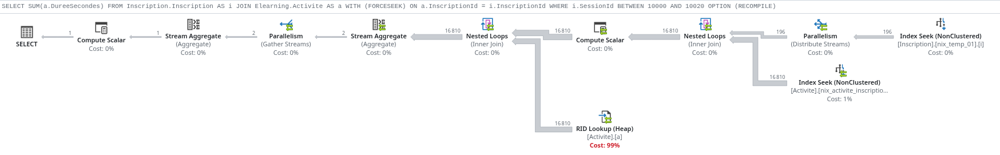

# html-query-plan

html-query-plan is a JavaScript library for showing Microsoft SQL Server execution plans in HTML.

This is a fork of [JustinPealing/html-query-plan](https://github.com/JustinPealing/html-query-plan)
that renders plans in pure TypeScript instead of the original XSLT stylesheet, because
`XSLTProcessor` [is deprecated](https://chromestatus.com/feature/5172738471690240) and will be
removed from browsers. The rendered markup is identical to the XSLT output, so existing CSS
and tooling keep working.

This copy (`rudi-bruchez/query-plan`) adds, on top of that fork:

- the operator icons of the Microsoft documentation, shown at 24 px, with Key Lookup and
  RID Lookup drawn the right way round (SSMS swaps them) and a RID Lookup that is no longer
  described as a Key Lookup;
- the row count on each arrow, as Plan Explorer shows it;
- sober nodes, the cost of expensive operators in color, and a dark theme;
- a `fitWidth` option that scales a wide plan down to its container;
- `visionneuse/`, the standalone viewer served at https://sqlplan.pachadata.com.

The build needs `NODE_OPTIONS=--openssl-legacy-provider` on Node 17 and later (webpack 4).



To use in a web page:

 - Find the latest release [here](https://github.com/JustinPealing/html-query-plan/releases/latest).
 - Include `qp.css` and `qp.min.js`
 - Call `QP.showPlan`, passing the container in which to show the plan and the query plan XML (as a string). 

```
<div id="container"></div>
<script>
    QP.showPlan(document.getElementById("container"), '<ShowPlanXML...');
</script> 
```

See the `examples` folder for complete examples.

## Options

Additional options can be passed using the 3rd argument:

```
<div id="container"></div>
<script>
    var options = {
        jsTooltips: false
    };
    QP.showPlan(document.getElementById("container"), '<ShowPlanXML...', options);
</script> 
```

| Option | Default | Description | 
| --- | --- | --- | 
| jsTooltips | true | Set to `false` to use CSS tooltips. | 
| theme | `"light"` | `"dark"`, or `"auto"` to follow `prefers-color-scheme`. `QP.setTheme(container, theme)` changes it afterwards, for a page with a theme switch. |
| fitWidth | 0 | Smallest scale (0 to 1) to which a plan wider than its container is reduced; a click toggles full size. 0 never scales. | 

## Pre-rendered plans

If the plan HTML has already been rendered (e.g. server-side), JavaScript is still needed to
draw the connecting lines. To do this, follow the above steps but call `QP.drawLines` instead:

```
<div id="container">
    <!-- Insert pre-rendered plan HTML here -->
</div>
<script>
    QP.drawLines(document.getElementById("container"));
</script>
```

## Browser Support

Should work just fine in any modern browser. Tested in Chrome, Firefox and IE9+. IE8 and earlier have known issues.

## Icons

Meaning of the "overlay" icons for nodes:

| Icon | Description | 
| --- | --- | 
|  | Either the actual execution mode was "Batch" (for actual execution plans), or the estimated execution mode was "Batch" (for estimated plans). | 
|  | The node was executed in parallel. |
|  | There are one or more warnings on the node. |

The operator icons are those of the Microsoft documentation
([MicrosoftDocs/sql-docs](https://github.com/MicrosoftDocs/sql-docs), *Showplan logical and
physical operators reference*), © Microsoft, licensed under
[CC BY 4.0](https://creativecommons.org/licenses/by/4.0/); their light background was made
transparent. `tools/sprite-microsoft.py <sql-docs clone>` rebuilds `css/qp_icons.png` and the
icon block of `css/qp.css` from them. The three overlays above come from the Fat Cow
"Farm Fresh" web icons pack, http://www.fatcow.com/free-icons (`tools/overlays.png`).

## Building

Run the following commands in bash to output minified and unminified versions in the `dist` folder:

    npm run webpack && NODE_ENV=production npm run webpack
    
# Sponsor

A big thankyou to [Brent Ozar Unlimited](https://www.brentozar.com/) (who make [Paste The Plan](https://www.brentozar.com/pastetheplan/)) for sponsoring development of html-query-plan.
